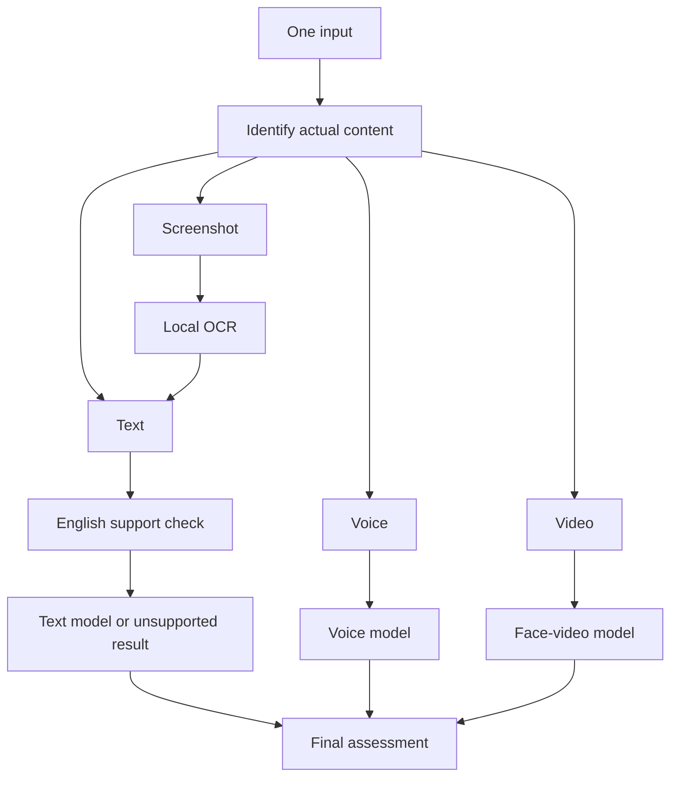

# How the demo workflow runs

This is a local workflow implemented in Python, similar to an n8n branching pipeline. It is not an n8n export and needs no external workflow account or API keys. `analysis.json` defines allowed stages, routes, queue limits and retry policy; `detector/workflow.py` executes the stages.

1. `POST /api/jobs` accepts either pasted text or one uploaded file. Ambiguous inputs are rejected. Jobs receive random IDs.
2. A single worker takes the next queued input. The bounded queue holds at most four pending/running jobs.
3. File signatures and image decoding identify screenshots. FFprobe stream metadata distinguishes audio from video, including audio-only MP4s and album art. Plain UTF-8 `.txt` files are supported.
4. Screenshots go through local Tesseract OCR with English, Hindi and Telugu packs. Extracted text follows the same text-assessment path. The interface language never translates input before detection.
5. The text model accepts English prose only. Hindi/Telugu and other detected non-Latin scripts receive an honest unsupported-language result with readable extracted text; no score is fabricated. Latin-script input is assumed English; this is not comprehensive language identification.
6. The model route runs and produces a structured result. The browser polls actual stage/status values; progress is not a fake percentage. The interface and results are localised into English, Hindi and Telugu.
7. Failed steps end with a translated, actionable error. A corrupt input produces no verdict. Uploaded files are deleted in `finally`, including failed checks. A failed job does not poison later jobs.
8. The browser automatically retries up to three failed polling requests. Reconnect resumes the same job. Invalid media and model failures are not retried as if they were successful.

Finished jobs expire after 15 minutes and are pruned on access/submission. No more than 32 completed/failed results are retained between pruning operations. Restarting the server loses jobs; this is a single-process demo, not a durable distributed queue. Run Uvicorn with **one worker**. The random job ID is a capability token; do not share it if the result is private.

`GET /api/workflow` exposes the stage/route definition. `GET /api/health` checks required files and executable presence, not model accuracy.

## Automated checks

GitHub Actions runs on every push, pull request, or manual dispatch. It installs FFmpeg, OCR tools and fonts explicitly, verifies model downloads, tests actual inference and failure cases, runs the video upload fixture, and tests the unified UI with Chromium. Screenshots are uploaded as an Actions artifact. Failed checks remain visible; the workflow does not silently edit source code or claim to repair arbitrary future failures.
